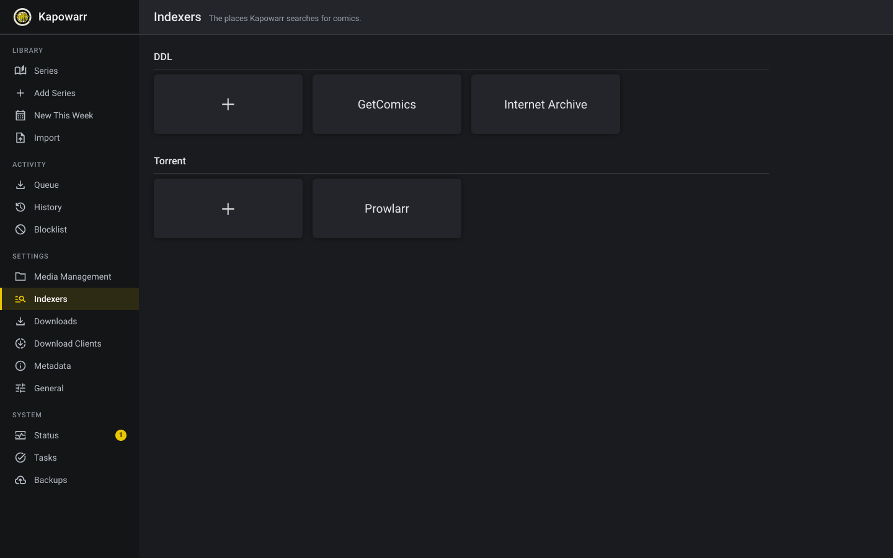

# Kapowarr, with Prowlarr and the Internet Archive

[](https://github.com/Hikki-dev/Kapowarr/actions/workflows/ci.yml)
[](LICENSE)
[](https://github.com/Hikki-dev/Kapowarr/pkgs/container/kapowarr)
[](https://github.com/Casvt/Kapowarr)

Build a comic library and keep it up to date, from every place comics can be found.

<p align="center"></p>

<p align="center"><sub>Three places to look, set up once.</sub></p>

This is [Kapowarr](https://github.com/Casvt/Kapowarr), the comic manager that works like Sonarr and Radarr, on top of its newest work, with two more places to look. **Prowlarr** searches all your torrent sites at once, and the **Internet Archive** has public domain and archived comics you can download directly. It is made for comics. Manga belongs to [Kaizoku](https://github.com/Hikki-dev/Rensaio).

You add a series once. Kapowarr finds the issues, downloads them, renames them and files them in the right folder. You do not need to know where comics come from.

## On this page

* [What is different](#what-is-different)
* [Prowlarr, the quick way](#prowlarr-the-quick-way)
* [Run it](#run-it)
* [Coming from an older copy](#coming-from-an-older-copy)
* [Light on your computer](#light-on-your-computer)
* [Made with care](#made-with-care)
* [Help and more reading](#help-and-more-reading)
* [Credits and licence](#credits-and-licence)

## What is different

Everything Kapowarr does is still here, including what the original added in October 2026: a fix for how GetComics pages are read, fixes for the database locking while many downloads start, torrent indexers (Torznab), and safer logs. On top of that:

| What | In plain words |
|---|---|
| Prowlarr as an indexer | One search asks every torrent site you set up in Prowlarr. Comics are searched first, so an answer comes in about ten seconds instead of more than a minute, and with results that are really comics. The API key travels in a header, so it never shows in a log |
| The Internet Archive as an indexer | Finds public domain and archived comics and downloads the files directly. Titles such as "Batman: Year One" or "Saga (2012)" work, and the page images and text files the archive makes by itself are left out |
| Torrent links that always work | Some sites give a magnet link, some a link that leads to one, some the `.torrent` file itself. All three are turned into a magnet link, whatever the site calls the file, and a file that is too big to be a real torrent is ignored |
| Upgrading from an older copy | A database from the earlier version of this copy is brought over by itself. Your library, your downloads and your qBittorrent are kept, and your Prowlarr settings become a Prowlarr indexer |

## Prowlarr, the quick way

Open Settings, Indexers, add **Prowlarr**, and enter its address and API key. Kapowarr tests the connection and tells you if the key is wrong. If you install with [media-server-setup](https://github.com/Hikki-dev/media-server-setup), this is done for you.

## Run it

```bash
docker run -d --name kapowarr --restart unless-stopped -p 5656:5656 \
  -e PUID=1000 -e PGID=1000 -e TZ=UTC \
  -v kapowarr-db:/app/db \
  -v /path/to/downloads:/app/temp_downloads \
  -v /path/to/comics:/comics-1 \
  ghcr.io/hikki-dev/kapowarr:latest
```

Open `http://your-server:5656`. You need a free [ComicVine key](https://comicvine.gamespot.com/api) so Kapowarr can look up comics.

## Coming from an older copy

Back up the database volume, then start this image on the same volume. The database is upgraded on the first start, and the older Prowlarr settings become an indexer. Nothing else needs doing.

## Light on your computer

About 100 MB of memory when idle and a 170 MB image. There is no second database server, no browser and nothing compiled when you install. The image is built for Intel/AMD and ARM (the ARM build is made but not yet run on a real Raspberry Pi), and it tells Docker when it is healthy.

## Made with care

* The new parts have their own checks, which run without internet on every change, together with the checks of the original.
* A copy of a real library's database was upgraded offline to make sure nothing is lost on the way.
* New versions are built for Intel/AMD and ARM automatically and are only published when the checks pass.
* This copy follows the original's newest work. It changes only what is listed above, so new work from the original can be brought in.

## Help and more reading

* [docs/Original README.md](docs/Original%20README.md): the original Kapowarr page
* [Kapowarr documentation](https://casvt.github.io/Kapowarr/): how every setting works
* [Issues](https://github.com/Hikki-dev/Kapowarr/issues): ask a question or report something that went wrong

## Credits and licence

All credit to Cas van Tijn and the Kapowarr contributors. This copy follows Kapowarr's `development` branch of 2 November 2026 (version 1.3.2 plus unreleased work). The licence is unchanged: GPL-3.0, see [LICENSE](LICENSE).

Comics come from third-party websites. Use this only for content you have the right to download.
