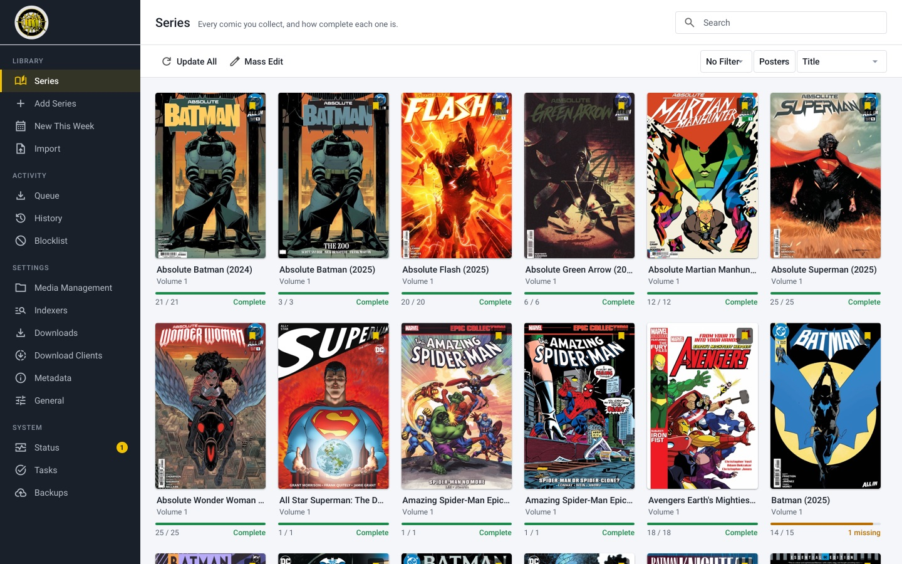
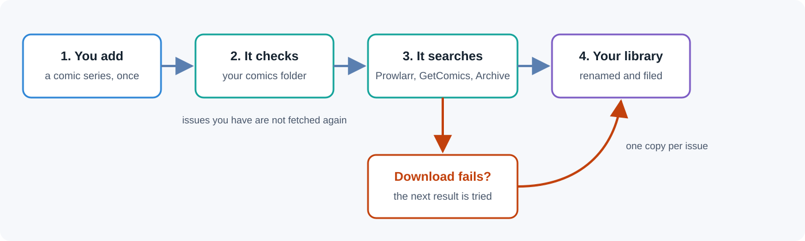
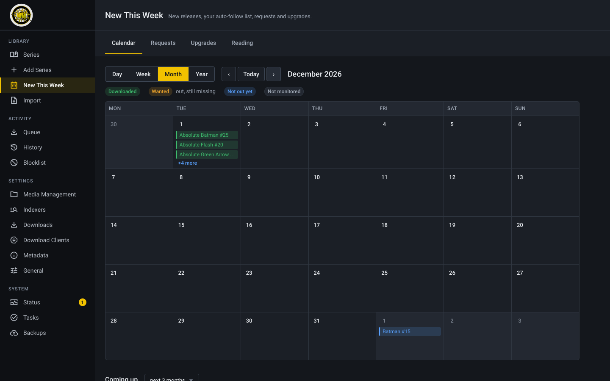
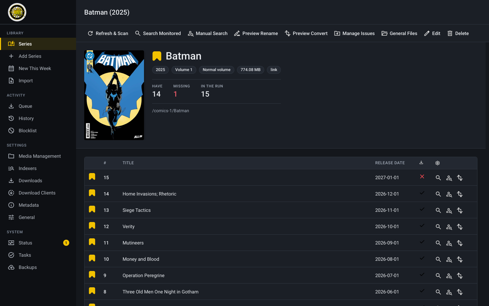
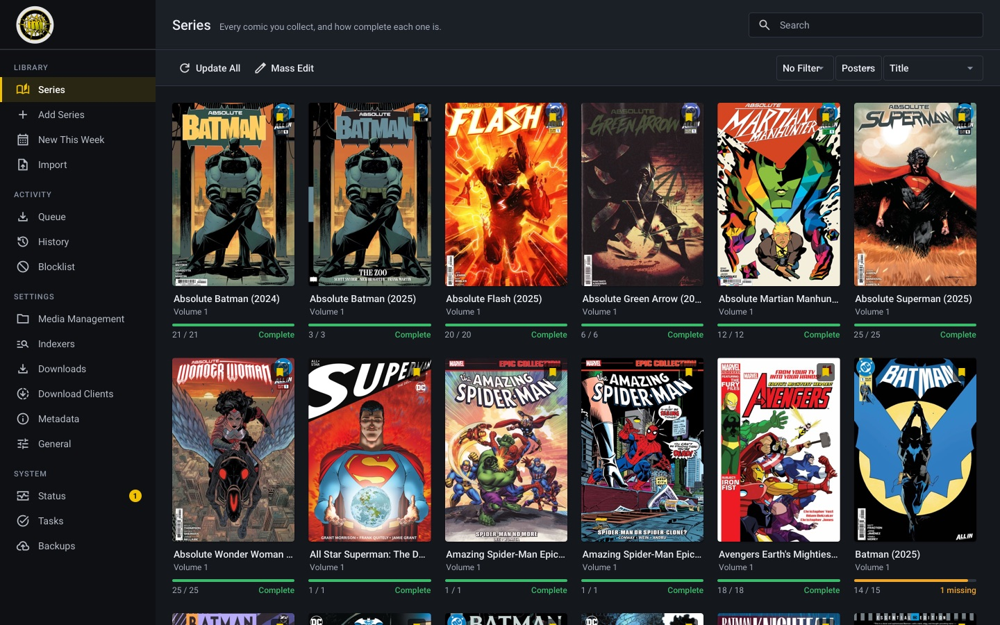
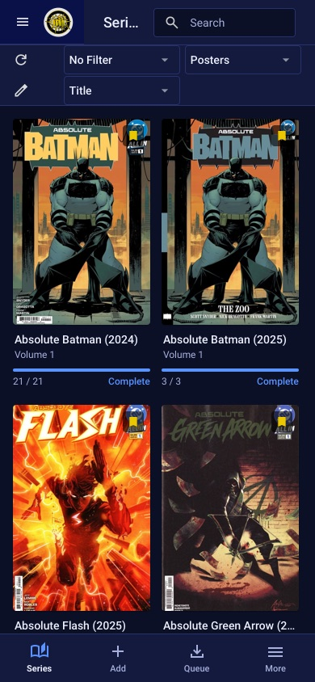

# Kapowarr, with Prowlarr and the Internet Archive

[](https://github.com/Hikki-dev/Kapowarr/actions/workflows/ci.yml)
[](LICENSE)
[](https://github.com/Hikki-dev/Kapowarr/pkgs/container/kapowarr-fork)
[](https://github.com/Casvt/Kapowarr)

Build a comic library and keep it up to date, from every place comics can be found.

<p align="center"></p>

<p align="center"><sub>Your shelf. Every comic shows how complete it is.</sub></p>

This is a fork of [Kapowarr](https://github.com/Casvt/Kapowarr), the comic manager that works like Sonarr and Radarr. It follows the original's newest work and adds two more places to look. **Prowlarr** searches all your torrent sites at once, and the **Internet Archive** has public domain and archived comics you can download directly. It is made for comics. Manga belongs to [Kaizoku](https://github.com/Hikki-dev/Rensaio).

You add a series once. Kapowarr finds the issues, downloads them, renames them and files them in the right folder. You do not need to know where comics come from.

<p align="center"></p>

<p align="center"><sub>How a comic is added and kept up to date.</sub></p>

## On this page

* [What is different](#what-is-different): the four changes, side by side with the original
* [How an issue travels](#how-an-issue-travels): from adding a series to a comic on your shelf
* [Prowlarr, the quick way](#prowlarr-the-quick-way)
* [A clearer interface](#a-clearer-interface): the new look, for beginners and daily users
* [Extras](#extras-calendar-requests-upgrades-reading): the new page
* [Tell me when it happens](#tell-me-when-it-happens): messages, Komga, hardlinks and numbers
* [Run it](#run-it): one command, or Compose, and what each setting is for
* [Coming from an older copy](#coming-from-an-older-copy)
* [Light on your computer](#light-on-your-computer)
* [Made with care](#made-with-care)
* [Staying a true fork](#staying-a-true-fork)
* [Help and more reading](#help-and-more-reading)
* [Credits and licence](#credits-and-licence)

## What is different

Everything Kapowarr does is still here, including what the original added in October 2026: a fix for how GetComics pages are read, fixes for the database locking while many downloads start, torrent indexers (Torznab), and safer logs. On top of that:

| What | In plain words |
|---|---|
| A clearer interface | Familiar like Sonarr and Radarr, and easier to read. A sidebar with sections, a title and one plain sentence on every page, a setup checklist, "3 missing" or "Complete" on every comic, a summary on each series, and a tab bar on phones. See [the interface](docs/Interface.md) |
| Prowlarr as an indexer | One search asks every torrent site you set up in Prowlarr. Comics are searched first, so an answer comes in about ten seconds instead of more than a minute, and with results that are really comics. The API key travels in a header, so it never shows in a log |
| The Internet Archive as an indexer | Finds public domain and archived comics and downloads the files directly. Titles such as "Batman: Year One" or "Saga (2012)" work, and the page images and text files the archive makes by itself are left out |
| Torrent links that always work | Some sites give a magnet link, some a link that leads to one, some the `.torrent` file itself. All three are turned into a magnet link, whatever the site calls the file, and a file that is too big to be a real torrent is ignored |
| Better results first | A torrent nobody shares is put last, and between equal results the one with more seeders comes first. If a search finds nothing, a looser one (without year, volume and issue number) is tried. The same search within ten minutes is answered from memory, so Prowlarr is not asked again |
| Hardlinks | A finished torrent is hard linked into your library: instant, no second copy on the disk, and it keeps seeding. When the two folders are on different drives it is copied as before |
| Zipped downloads | A `.zip` or `.rar` with CBZ, CBR or PDF issues inside is checked, unpacked in a separate folder and its issues filed in the library, without changing their format. Nothing is overwritten, and the archive is only deleted once its issues are in. See [Zipped downloads](docs/Zipped%20downloads.md) |
| Metadata for Komga | Every CBZ gets a ComicInfo.xml (series, issue number, title, summary, date, publisher) and each series folder a cover and a series.json, after every download and every refresh. Other tools' details are kept. See [Metadata for Komga](docs/Metadata%20for%20Komga.md) |
| Safe downloads | Every finished download is checked before it is filed: programs and scripts (`.exe`, `.bat`, `.ps1`, `.sh`, ...), files that are not what their name says, archives with a program inside and PDFs that run code are refused, blocklisted and deleted. See [Safe downloads](docs/Safe%20downloads.md) |
| More folders | Add a root folder for each library (Comics, Manga, Manga 18+), creating it from the page, and move a series between them. See [Folders](docs/Folders.md) |
| Tells you things | A message (ntfy, Discord or any webhook) when a comic is imported or a download fails, and Komga is asked to scan so the comic shows up at once. Both are switched on with environment variables |
| Numbers to watch | `/api/system/metrics` gives queue size, library size and how Prowlarr is doing, for Homepage, Beszel or Prometheus |
| A release calendar | New This Week has a Day, Week, Month and Year calendar of the release dates your library knows, a "Coming up" list of the next issue of every series, and the new series that start. Series that match your watch list Series that match your watch list (a publisher, or a word in the title) are added and searched for by themselves |
| Requests | Ask for a series on the Extras page: it is added, searched for, and its state is shown (searching, downloading, complete) |
| Quality upgrades | Lists issues whose file is in a less wanted format than your format preference, and looks for better ones |
| Reading progress | With Komga set up, shows what you have read, and series you are caught up on are searched first |
| Upgrading from an older copy | A database from the earlier version of this copy is brought over by itself. Your library, your downloads and your qBittorrent are kept, and your Prowlarr settings become a Prowlarr indexer |

## How an issue travels

1. You add a series (a "volume") and pick the root folder it lives in.
2. Kapowarr reads the folder and marks the issues you already have.
3. For the issues you are missing, it asks every source you switched on: **GetComics**, the **Internet Archive** and **Prowlarr** (which asks all your torrent sites at once).
4. The best matching result is downloaded. A direct download goes straight to the folder. A torrent link is turned into a magnet link and handed to qBittorrent, and the finished file is copied in.
5. The file is renamed and filed in the series folder. If a download fails, the next result is tried.
6. A scheduled task looks again for new issues, so they arrive by themselves.

## Prowlarr, the quick way

Open Settings, Indexers, add **Prowlarr**, and enter its address and API key. Kapowarr tests the connection and tells you if the key is wrong. If you install with [media-server-setup](https://github.com/Hikki-dev/media-server-setup), this is done for you.

For torrents you also need a download client: Settings, Download Clients, add **qBittorrent**. Kapowarr must be able to see qBittorrent's download folder at the same path. See [Prowlarr and torrents](docs/Prowlarr%20and%20torrents.md) for the full steps.

## A clearer interface

The same Kapowarr, laid out like Sonarr and Radarr and made easier to read: one typeface, one icon set, plain words, and the same spacing everywhere. Everything is still where it was, and light is the default. The full tour, with the reasons, is in [The interface](docs/Interface.md).

<p align="center"> </p>

<p align="center"> </p>

## Extras: calendar, requests, upgrades, reading

Open **New This Week** in the menu (the page is called Extras in the code). It has four tabs. All of it is explained in [Extras](docs/Extras.md).

* **Calendar:** a Day, Week, Month and Year calendar of what comes out, a "Coming up" list of the next issue of every series, and the new series starting. Add publishers or words to the watch list and matching new series are followed for you.
* **Requests:** search for a series and press Request. Anyone who can open Kapowarr can ask; the list shows how far each request got.
* **Upgrades:** issues whose file is in a less wanted format than your preference, with a button to look for a better one.
* **Reading:** your progress from Komga.

## Tell me when it happens

Four optional features need no setting screen. Add the environment variable to the container and restart it. Full details are in [Notifications, Komga and metrics](docs/Notifications%20Komga%20and%20metrics.md).

| Variable | What it does |
|---|---|
| `KAPOWARR_NOTIFY_URL` | An ntfy topic, a Discord webhook or any URL. Gets a message when a comic is imported and when a download fails |
| `KAPOWARR_KOMGA_URL` with `KAPOWARR_KOMGA_API_KEY` | Starts a Komga scan after each import |
| `KAPOWARR_HARDLINK=0` | Turns hardlinking off and always copies |
| (always on) `/api/system/metrics` | Plain-text numbers for dashboards |

## Run it

```bash
docker run -d --name kapowarr --restart unless-stopped -p 5656:5656 \
  -e PUID=1000 -e PGID=1000 -e TZ=UTC \
  -v kapowarr-db:/app/db \
  -v /path/to/downloads:/app/temp_downloads \
  -v /path/to/comics:/comics-1 \
  ghcr.io/hikki-dev/kapowarr-fork:latest
```

Open `http://your-server:5656`. You need a free [ComicVine key](https://comicvine.gamespot.com/api) so Kapowarr can look up comics. Then add a root folder (`/comics-1` in the command above), add a series, and press **Search Monitored**.

The same thing with Docker Compose is in [docker-compose.yml](docker-compose.yml).

| Setting | What it does |
|---|---|
| `-p 5656:5656` | The web page. Change the left number if 5656 is taken |
| `-v kapowarr-db:/app/db` | Your database: library, settings, history. Back this up |
| `-v /path/to/downloads:/app/temp_downloads` | Where files are downloaded before they are filed |
| `-v /path/to/comics:/comics-1` | Your comics. Add `/comics-1` as a root folder in Kapowarr |
| `PUID` / `PGID` | The user and group that own the files. Use `0` to run as root, or your own ids (`id -u`, `id -g`) |
| `TZ` | Your time zone, for the schedule and the logs |

The image tells Docker when it is healthy, so `docker ps` shows `(healthy)` once the web page is up. [Troubleshooting](docs/Troubleshooting.md) covers the usual problems.

## Coming from an older copy

Back up the database volume, then start this image on the same volume. The database is upgraded on the first start, and the older Prowlarr settings become an indexer. Nothing else needs doing.

This also works from the original Kapowarr. Databases made by versions 1.0.0, 1.1.0, 1.2.0, 1.3.0, 1.3.1 and 1.3.2 were each upgraded with this image and came out with the library, root folder and settings intact, the Internet Archive added, and a clean integrity check.

## Light on your computer

About 100 MB of memory when idle and a 170 MB image. There is no second database server, no browser and nothing compiled when you install. The image is built for Intel/AMD and ARM (the ARM build is made but not yet run on a real Raspberry Pi), and it tells Docker when it is healthy.

## Made with care

* The new parts have their own checks, which run without internet on every change, together with the checks of the original.
* A copy of a real library's database, and databases made by each original release from 1.0.0 to 1.3.2, were upgraded offline to make sure nothing is lost on the way.
* A torrent link from Prowlarr was followed all the way: turned into a magnet link, accepted by qBittorrent and downloaded. What happens after the download finishes (moving the comic into the library) is the original's own part and was not run on a real comic torrent.
* New versions are built for Intel/AMD and ARM automatically and are only published when the checks pass.
* This copy follows the original's newest work. It changes only what is listed above, so new work from the original can be brought in. A weekly check does that merge for you and opens a pull request, or an issue when it does not merge cleanly. See [Keeping up with Kapowarr](docs/Keeping%20up%20with%20Kapowarr.md).

## Staying a true fork

This repository is a GitHub fork of [Casvt/Kapowarr](https://github.com/Casvt/Kapowarr). Nothing is ever pushed to the original; new work flows one way, from the original into this copy. Every change this copy makes is listed in [FORK-NOTES.md](FORK-NOTES.md), file by file, so a merge stays easy.

## Help and more reading

* [FORK-NOTES.md](FORK-NOTES.md): every change in this fork and the files it touches
* [docs/README.md](docs/README.md): all the guides of this fork
* [docs/Original README.md](docs/Original%20README.md): the original Kapowarr page
* [Kapowarr documentation](https://casvt.github.io/Kapowarr/): how every setting works
* [Issues](https://github.com/Hikki-dev/Kapowarr/issues): ask a question or report something that went wrong

## Credits and licence

All credit to Cas van Tijn and the Kapowarr contributors. This copy follows Kapowarr's `development` branch of 2 November 2026 (version 1.3.2 plus unreleased work). The licence is unchanged: GPL-3.0, see [LICENSE](LICENSE).

Icons are Material Symbols by Google and the typeface is Roboto, both under the Apache 2.0 licence.

Comics come from third-party websites. Use this only for content you have the right to download.
