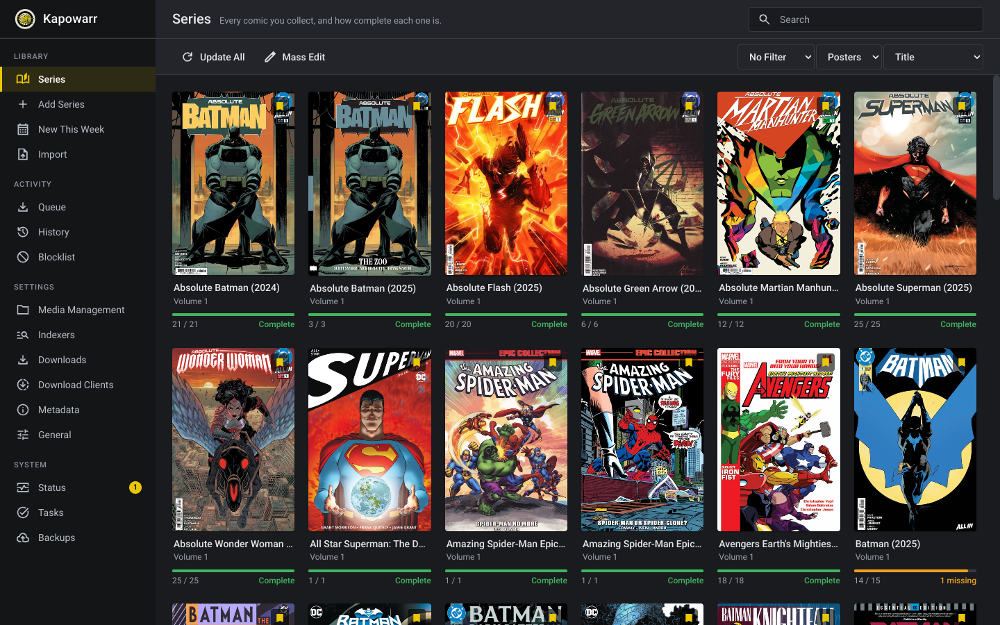
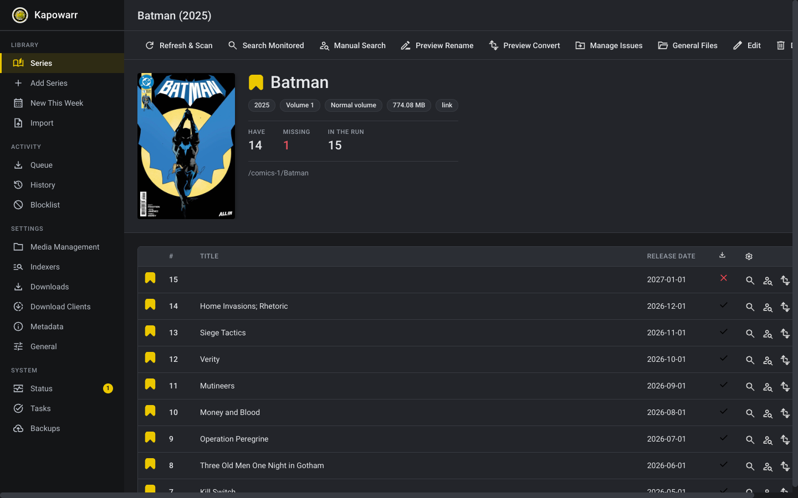
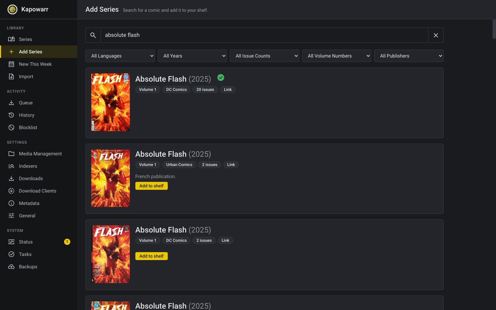
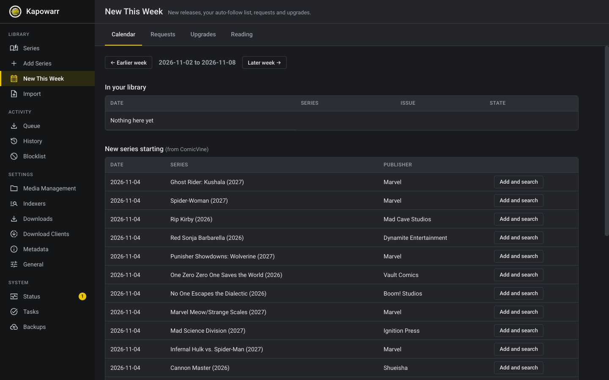
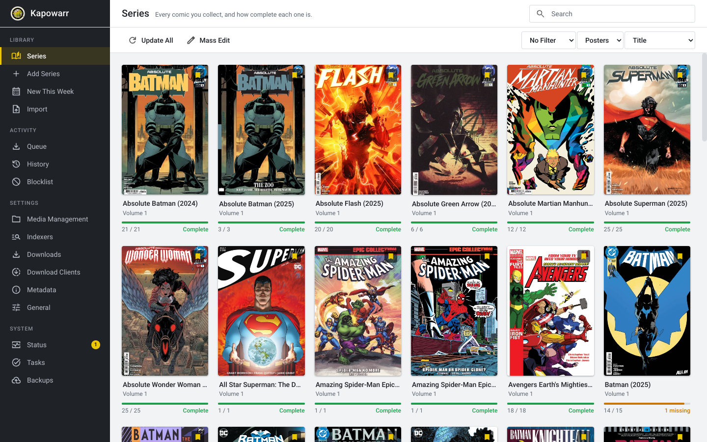
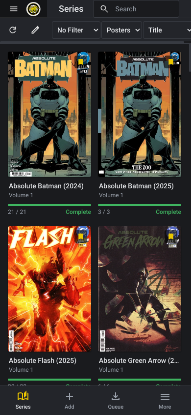

# The interface

The look of Kapowarr follows Sonarr and Radarr, so it is familiar, and it is
tidied so a beginner can find things and a daily user can work quickly. It
changes only how things look and are worded. Every feature, page and
address of Kapowarr is still there.

## Finding your way

- **A sidebar with sections.** Library (Series, Add Series, New This Week, Import), Activity (Queue, History, Blocklist), Settings and System. The page you are on is marked with a gold bar. The Queue shows a number while downloads are running, and Status shows a number when something needs attention.
- **A title and a plain sentence on every page.** The top bar says where you are and what the page is for, for example "Series: Every comic you collect, and how complete each one is."
- **Queue, History and Blocklist are tabs of one place**, so you can move between them in one click.
- **On a phone**, a bar at the bottom has Series, Add, Queue and More. More opens the full menu.

## Seeing how complete a series is

- Each cover on the shelf shows a bar and a count such as `14 / 15`, and the words **Complete** or **1 missing**. Green is complete, amber is partly there, red is nothing yet. Colour is never the only signal.
- A gold bookmark on the cover means the series is monitored.
- The series page opens with **Have, Missing and In the run**, then the issue list.
- All the toolbar buttons have a visible name next to the icon.

## First run

When the root folder, the ComicVine key or a download client is missing, the shelf starts with a short **Finish setting up** card. Each step is a link to the right settings page and ticks itself when done. An empty shelf says what to do next, with a button to add the first series.

## Adding comics

Type a name and press Enter. Results come from ComicVine. Each card says **Add to shelf**, or shows a green tick if you already have it.

## Settings

On/off options are switches. Every setting keeps its explanation underneath it.

## New This Week

The page that used to be called Extras. See [Extras](Extras.md).

## Light and dark

Dark is the default, as in Sonarr. Change it under Settings, General, Theme.

## On a phone

## Design rules

- **One typeface**, Roboto, in regular, medium and bold. Nothing decorative.
- **One icon set**, Material Symbols Sharp, drawn at one weight and size, instead of a mix of styles. The icons are in `frontend/static/img` and `frontend/static/img/ui`.
- **Gold (`#ebc700`) is used sparingly**: the current page, the main button on a page and the monitored bookmark. Status uses green, amber and red, and always with a word.
- **Spacing in steps of 4 pixels**, rows 44 pixels high, buttons 36 pixels, so lists line up and are easy to tap.
- **Respects "reduce motion"** and keeps a visible focus ring for keyboard use.

## For developers

- `frontend/static/css/kapowarr.css` is the skin. It loads after each page's own stylesheet and sets colours, type, spacing and components using the existing variables (`--background-color`, `--accent-color` and so on).
- `frontend/static/js/shell.js` adds the page titles, the setup card, the missing counts, the series summary, the activity tabs and the phone menu. It only adds information: if it fails, Kapowarr works as before.
- `frontend/templates/base.html` holds the sidebar and the tab bar.

Icons are Material Symbols by Google, licensed under Apache 2.0. The typeface Roboto is licensed under Apache 2.0.
