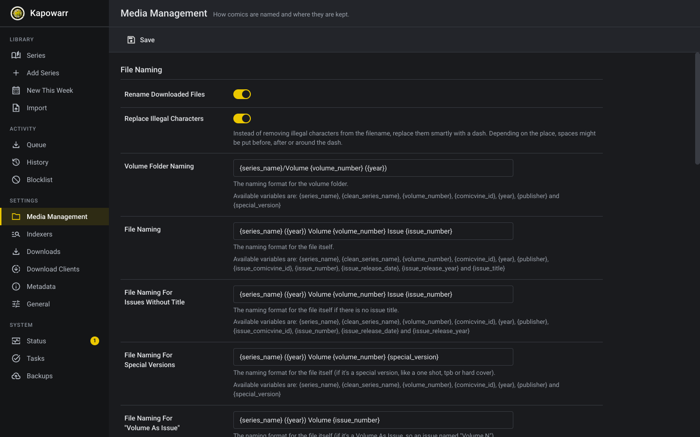
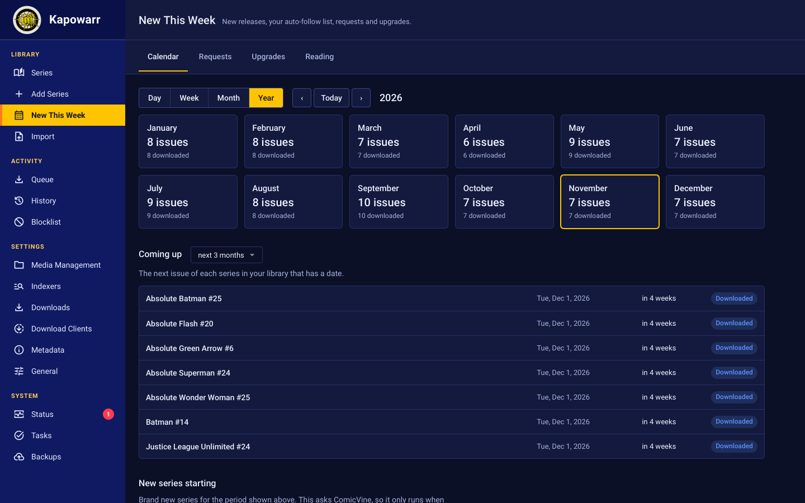
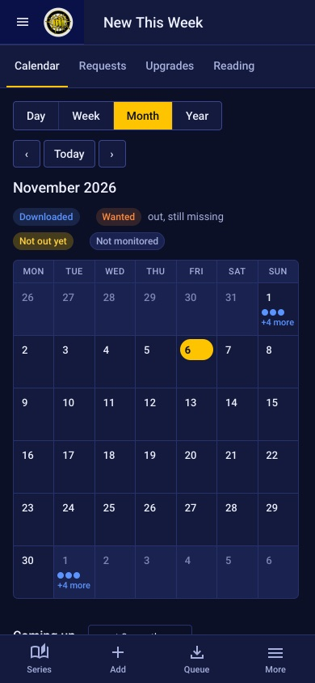

# The interface

The look of Kapowarr follows Sonarr and Radarr, so it is familiar, and it is
tidied so a beginner can find things and a daily user can work quickly. It
changes only how things look and are worded. Every feature, page and
address of Kapowarr is still there.

## Finding your way

- **A sidebar with sections.** Library (Series, Add Series, New This Week, Import), Activity (Queue, History, Blocklist), Settings and System. The page you are on is marked in yellow. The Queue shows a number while downloads are running, and Status shows a number when something needs attention.
- **A title and a plain sentence on every page.** The top bar says where you are and what the page is for, for example "Series: Every comic you collect, and how complete each one is."
- **Queue, History and Blocklist are tabs of one place**, so you can move between them in one click.
- **On a phone**, a bar at the bottom has Series, Add, Queue and More. More opens the full menu.

## Seeing how complete a series is

- Each cover on the shelf shows a bar and a count such as `14 / 15`, and the words **Complete** or **1 missing**. Blue is complete, orange is partly there, red is nothing yet. Colour is never the only signal.
- A yellow bookmark on the cover means the series is monitored.
- The series page opens with **Have, Missing and In the run**, then the issue list.
- All the toolbar buttons have a visible name next to the icon.

## First run

When the root folder, the ComicVine key or a download client is missing, the shelf starts with a short **Finish setting up** card. Each step is a link to the right settings page and ticks itself when done. An empty shelf says what to do next, with a button to add the first series.

## Adding comics

Type a name and press Enter. Results come from ComicVine. Each card says **Add to shelf**, or shows a tick if you already have it.

## Settings

On/off options are switches. Every setting keeps its explanation underneath it.

## New This Week: the calendar

The calendar answers "when does the next issue come out?". Pick **Day, Week, Month or Year**, move with the arrows (or the left and right arrow keys), and press **Today** to come back. Your choice of view is remembered.

- **Month** shows every day. An issue is a small label with the series and number, coloured by how it stands. More than three on one day: press "+ more", or the day number, to open that day.
- **Week** lists the seven days, with the empty ones kept short.
- **Day** is one list.
- **Year** shows twelve tiles with how many issues come out each month. Press a month to open it.
- **Coming up** lists the next issue of every series that has a date, for the next month, 3 months, 6 months or year, with "in 4 weeks".

Every label says its state in words as well as colour: **Downloaded** (blue), **Wanted** (orange, already out and still missing), **Not out yet** and **Not monitored**.

 

The dates come from your library, so the calendar works without internet. A date shows up once ComicVine knows it, so a series with nothing announced has nothing on the calendar. **New series starting** asks ComicVine and only runs when you press its button. See [Extras](Extras.md) for the rest of the page.

## Light and dark

Light is the default. Change it to dark under Settings, General, Theme.

## On a phone

## Colours

Four vivid colours, each with one job, on a bright page in light mode and deep navy (never grey) in dark mode.

| Job | Light | Dark |
|---|---|---|
| Sidebar | `#1a2db0` blue | `#101a62` deep blue |
| Page | `#f5f6fb` | `#0b1026` |
| Cards and bars | `#ffffff` | `#131a3d` |
| Text | `#141833` | `#eef1ff` |
| Quiet text | `#4d557a` | `#a7b1de` |
| **Blue**: you have it, links | `#1f55e0` | `#5b93ff` |
| **Orange**: partly there, wanted | `#c24a00` | `#ff8a3d` |
| **Yellow**: the current page, the main button, "not out yet" | `#ffc400` | `#ffc400` |
| **Red**: missing, errors, alerts | `#d1182b` | `#ff5468` |

Text on yellow is always the dark ink. Every colour pair is at least 4.5 to 1 against its background, and a state is never shown by colour alone: it always has a word.

## Design rules

- **The logo, large, with the name beside it**, at the top of the sidebar.
- **One typeface**, Roboto, in regular, medium and bold. Nothing decorative.
- **One icon set**, Material Symbols Sharp, drawn at one weight and size, instead of a mix of styles. The icons are in `frontend/static/img` and `frontend/static/img/ui`.
- **Yellow marks what to press or where you are**: the current page, the main button on a page and the monitored bookmark. Status uses blue, orange and red, and always with a word.
- **Spacing in steps of 4 pixels**, rows 44 pixels high, buttons 36 pixels, so lists line up and are easy to tap.
- **Respects "reduce motion"** and keeps a visible focus ring for keyboard use.

## For developers

- `frontend/static/css/kapowarr.css` is the skin. It loads after each page's own stylesheet and sets colours, type, spacing and components using the existing variables (`--background-color`, `--accent-color` and so on).
- `frontend/static/js/shell.js` adds the page titles, the setup card, the missing counts, the series summary, the activity tabs and the phone menu. It only adds information: if it fails, Kapowarr works as before.
- `frontend/templates/base.html` holds the sidebar and the tab bar.

Icons are Material Symbols by Google, licensed under Apache 2.0. The typeface Roboto is licensed under Apache 2.0.
